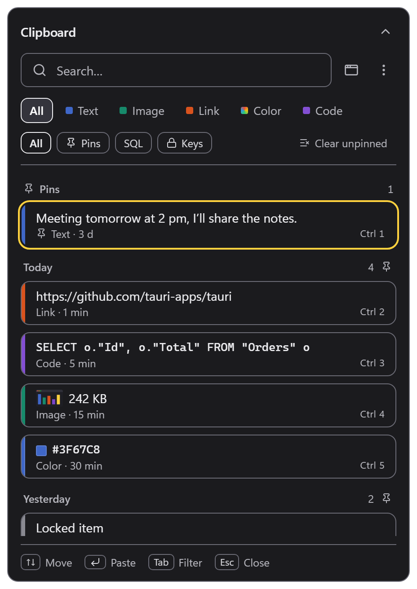
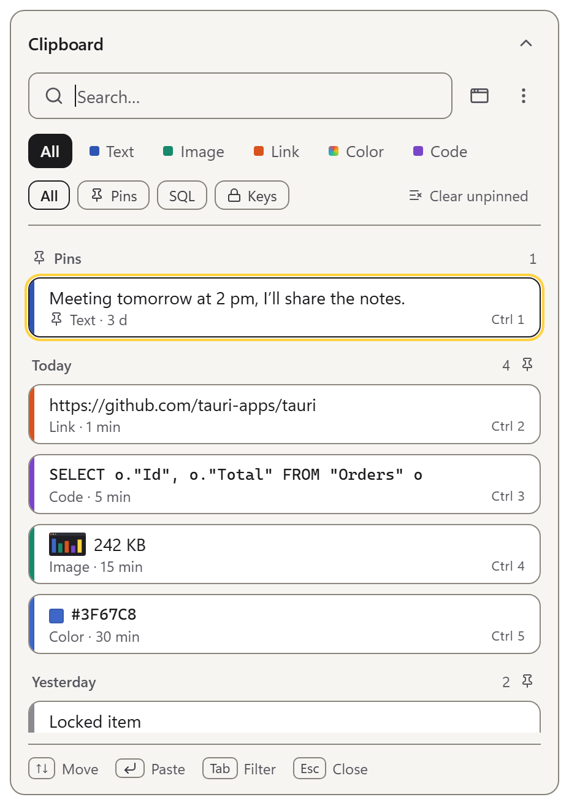
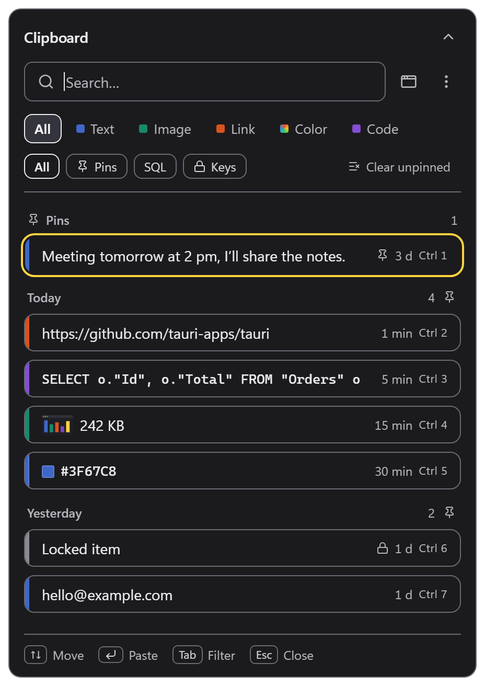
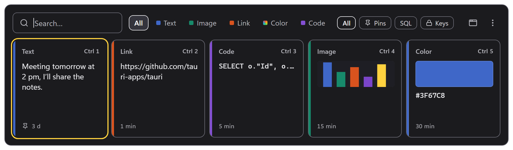
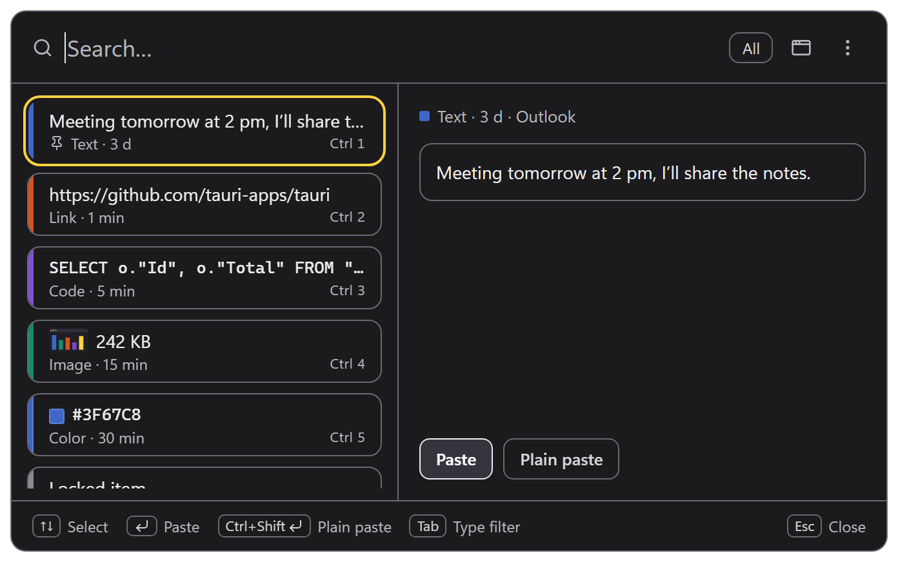
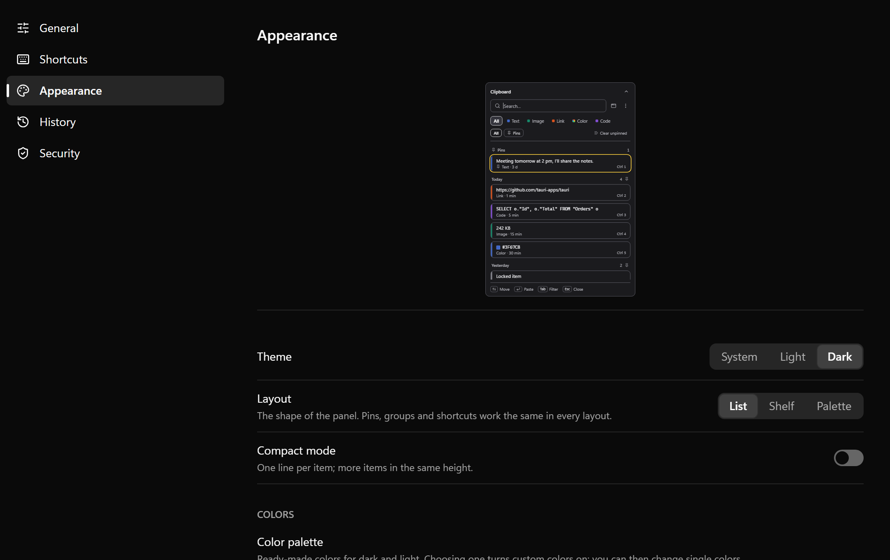

# Clipmoor

An encrypted clipboard history for Windows 10/11 that replaces Win+V.

<p align="center"></p>

## What it does

- **Replaces Win+V.** A low-level keyboard hook catches Win+V before Windows does. You can turn the takeover off, or move the panel to another shortcut.
- **Never steals focus.** The panel is a non-activating overlay, so the app you were typing in keeps focus and its open menus and popups stay open. Choosing an item pastes straight into that app.
- **Opens at the caret.** You can also place it at the mouse pointer or in the centre of the screen.
- **Three layouts plus a compact mode:** List, Shelf (a horizontal strip of cards) and Palette (a list with a detail pane). Compact mode shows one line per item.
- **Detects each item's type automatically:** text, image, link, colour or code. Each type gets its own colour band.
- **Pins and pin groups.** Pinned items never expire. Put them in named groups by dragging a card onto a group pill, or with right-click → Move to group.
- **Search and filters.** Typing searches straight away. Tab cycles the type filter, and Ctrl+K filters by source app.
- **Image preview** in a separate window (Ctrl+Space).
- **Quick numbers.** Ctrl+1–9 pastes one of the first nine visible items.
- **Plain paste** drops formatting (HTML, RTF and images) and pastes only the text.
- **Keep open.** The panel stays open after pasting and when you click elsewhere. With keep-open on, Esc collapses it to a small bar.
- **Configurable shortcuts**, with checks for clashes and for shortcuts Windows reserves.
- **Themes and colours:** light, dark or follow the system, five preset palettes, and your own colours for each theme.
- **Retention.** History keeps the last 500 items or 30 days by default, whichever limit is reached first. Pins don't count toward the limit.
- **English and Turkish UI.**

| List, light | Compact list |
|---|---|
|  |  |

**Shelf**



**Palette**



**Settings → Appearance**



## Privacy and security

- **Local only.** No account, no network access, no analytics. Data is stored in `%LOCALAPPDATA%\app.clipmoor`.
- **Encrypted at rest.** Every item is sealed with AES-256-GCM using its own key, derived with HKDF-SHA512 from a 512-bit master key. Duplicates are detected with a keyed HMAC, never with the plain content.
- **Master key protection.** The master key is wrapped by an RSA key in the TPM (Microsoft Platform Crypto Provider). If no TPM is available, DPAPI under your Windows account wraps it instead. Settings → Security shows which method is in use. If the key is lost, for example because the TPM was reset or Windows was reinstalled, the history cannot be recovered.
- **Windows Hello locks.** You can lock a single item, a whole pin group, or all history. A locked item's key is derived from the master key plus a Windows Hello signature, so it can't be decrypted without Hello. How long an unlock lasts is configurable: ask every time, 5 minutes, or while the app runs. Items lock again on Win+L, sleep and session change unless you turn that off.
- **Kept out of Windows clipboard history.** When you paste a locked item, Clipmoor marks it so that Windows clipboard history and clipboard monitors skip it. If Windows clipboard history is turned on, the Security page warns you, because Windows keeps its own unencrypted copies.
- **Excluded apps.** Anything copied from apps on this list is never saved, matched by process name. You can also pause capture from the tray icon.

## Default shortcuts

All of these can be changed in Settings → Shortcuts.

| Action | Shortcut |
|---|---|
| Open the panel | Win+V |
| Paste the selected item | Enter |
| Copy only (no paste) | Shift+Enter |
| Plain paste | Ctrl+Shift+Enter |
| Pin / unpin | Ctrl+P |
| Preview | Ctrl+Space |
| Source filter | Ctrl+K |
| Close | Esc |
| Quick number | Ctrl+1–9 |

These keys can't be changed: the arrow keys (move the selection), Home/End, Tab and Shift+Tab (cycle the type filter), Backspace, and typing (search). A mouse click pastes, and right-click opens the item menu.

## Install

1. Download `Clipmoor_<version>_x64-setup.exe` from [GitHub Releases](../../releases).
2. Run it. It installs for your user account only (`%LOCALAPPDATA%\Clipmoor`) and doesn't ask for administrator rights.
3. The installer is unsigned, so SmartScreen shows "Windows protected your PC". Click **More info**, then **Run anyway**.
4. The **Start with Windows** box on the last page is unchecked by default. You can change it later in Settings.

Good to know:

- Unsigned apps don't run on machines with **Smart App Control** turned on.
- If a window running as administrator is in the foreground, Win+V opens the Windows clipboard panel instead.
- Uninstalling removes the Start with Windows entry. Your data is kept unless you tick the delete application data box on the uninstall screen.

## Build from source

Prerequisites:

- Windows 10 or 11 (x64)
- Rust (stable)
- Node.js 24 and pnpm 10
- Visual Studio C++ build tools with the Windows SDK
- WebView2 runtime (already installed on Windows 11)

```sh
pnpm install
pnpm tauri dev      # run with hot reload
pnpm tauri build    # NSIS installer in src-tauri/target/release/bundle/nsis
```

Tests:

```sh
pnpm test                                   # frontend (Vitest)
cargo test --manifest-path src-tauri/Cargo.toml
```

## Releasing

Push a tag named `vX.Y.Z`. The [Release workflow](.github/workflows/release.yml) sets the app version from the tag, runs both test suites, builds the installer and creates a **draft** GitHub release with the installer attached. Publish the draft by hand.

## Project structure

```
src/                    React UI (one bundle for every window)
  app/                  window entry points: panel, settings, preview
  components/           panel (layouts: list, shelf, palette), settings, preview, ui
  services/             typed wrappers around Tauri commands and events
  types/  utils/        shared types; pure logic (state, shortcuts, colours), unit tested
  locale/  lib/         TR/EN strings; tokens, themes, StyleX helpers
src-tauri/src/          Rust backend: capture, store (SQLite), crypto, keys, settings
  win/                  Win32: keyboard hook, caret, paste, clipboard, Hello, TPM/DPAPI key wrap, tray
design-system/          design tokens (tokens.dtcg.json) and component notes
```

## Status

Windows only (x64). Early version (0.1.0).

License: TBD.
